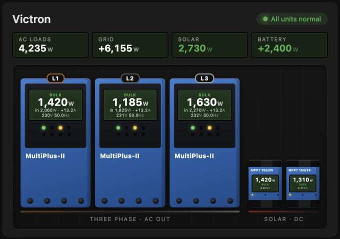
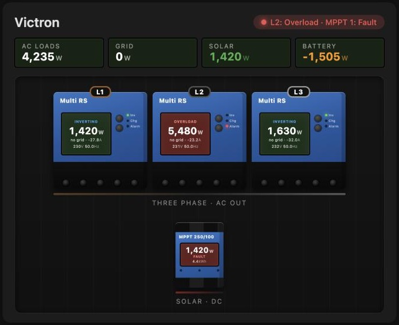

# Inverter Stack Card

[](https://my.home-assistant.io/redirect/hacs_repository/?owner=SvenHamers&repository=inverter-stack-card&category=plugin)



A Lovelace card for Home Assistant that draws your inverter / chargers and solar chargers as the devices themselves, hanging on a wall: a three-phase set side by side with its phase tags, the solar chargers next to it, each with a screen and the lights of the real front panel.

- **Models:** MultiPlus-II, Quattro and Multi RS inverter / chargers, and SmartSolar MPPT solar chargers (small, like a 100/20 or 150/35, or large, like a 250/100). They're drawn in roughly their real proportions, so a Quattro looks bigger than a MultiPlus-II and a small MPPT is small.
- **Single phase, split phase, three phase or parallel:** give each unit its phase (L1, L2, L3) and the card labels the set.
- **Each unit's screen** shows its state, power, AC-in power, DC current, voltage and frequency, each only when you've set that entity. The lights follow the state: mains on, inverter on, bulk, absorption, float, overload, low battery, temperature.
- **State as text or as a number:** the VE.Bus and solar charger state numbers from Victron's Modbus / D-Bus (3 = Bulk, 9 = Inverting, …) are translated.
- **Alarms:** a fault state or an alarm entity turns that unit's screen red and names it in the header.
- **Optional totals** above the wall: AC loads, grid, solar and battery power.
- **Compact or large**, scaled to the card's width; on a narrow card the phase set shrinks to fit and the solar chargers move below it.
- **Nothing is fixed to one integration:** you pick every entity yourself, in the card editor or in YAML. It works with the Victron GX Modbus integration, Venus OS over MQTT, or anything else that gives you the sensors.

Fits with [Battery Pack Card](https://github.com/SvenHamers/battery-pack-card) and [Breaker Board Card](https://github.com/SvenHamers/breaker-board-card): the same dark screens and tints, so they read as one system when stacked on a dashboard.



## Install

### Via HACS (recommended)

Click the badge above: it opens your Home Assistant with the HACS custom-repository dialog filled in. Press **Add**, download **Inverter Stack Card**, then hard-refresh the dashboard.

Or by hand: HACS → ⋮ → Custom repositories → add `https://github.com/SvenHamers/inverter-stack-card` with type **Dashboard** → download **Inverter Stack Card** → hard-refresh (Ctrl/Cmd+Shift+R).

### Manual

1. Copy `inverter-stack-card.js` to `/config/www/`.
2. Settings → Dashboards → ⋮ → Resources → add `/local/inverter-stack-card.js` as type **JavaScript module**.
3. Hard-refresh.

## Usage

Add it from the dashboard with **Add card** → **Inverter Stack Card**. The editor has the general options and the totals, then one block per inverter and per solar charger: pick the model, the phase and the entities. **+ Add inverter** fills in the next phase for you (L1 → L2 → L3).

Or in YAML, for example a three-phase MultiPlus-II system with two solar chargers:

```yaml
type: custom:inverter-stack-card
name: Victron
entity_loads: sensor.ac_consumption
entity_grid: sensor.grid_power
entity_solar: sensor.pv_power
entity_battery: sensor.battery_power
inverters:
  - model: multiplus2
    phase: L1
    label: 48/5000/70-50
    power: sensor.vebus_ac_out_l1_power
    state: sensor.vebus_state
    ac_in_power: sensor.vebus_ac_in_l1_power
    voltage: sensor.vebus_ac_out_l1_voltage
    frequency: sensor.vebus_ac_out_frequency
    dc_current: sensor.vebus_dc_current
    alarm: sensor.vebus_alarm_overload_l1
  - model: multiplus2
    phase: L2
    power: sensor.vebus_ac_out_l2_power
    state: sensor.vebus_state
  - model: multiplus2
    phase: L3
    power: sensor.vebus_ac_out_l3_power
    state: sensor.vebus_state
chargers:
  - model: mppt_small
    label: 150/35
    power: sensor.mppt_1_pv_power
    state: sensor.mppt_1_state
    yield_today: sensor.mppt_1_yield_today
  - model: mppt_large
    label: 250/100
    power: sensor.mppt_2_pv_power
```

The entity names above are only examples; use whatever your integration provides.

## Options

| Option           | Type   | Default     | Description |
| ---------------- | ------ | ----------- | ----------- |
| `name`           | string | `Inverters` | Title. |
| `size`           | string | `compact`   | `compact` or `large`. |
| `entity_loads`   | entity | —           | Total AC loads, shown above the wall. |
| `entity_grid`    | entity | —           | Grid power. |
| `entity_solar`   | entity | —           | Solar power. |
| `entity_battery` | entity | —           | Battery power (positive = charging). |
| `inverters`      | list   | —           | The inverter / chargers, see below. |
| `chargers`       | list   | —           | The solar chargers, see below. |

Totals only show for the entities you set. All powers can be in W or kW.

### Inverter / charger

| Field         | Description |
| ------------- | ----------- |
| `model`       | `multiplus2`, `quattro` or `multi_rs`. |
| `phase`       | `L1`, `L2` or `L3`: the tag on top of the unit, in the European wire colour (brown, black, grey). |
| `name`        | Tag text instead of the phase, e.g. "Unit 2" for units in parallel. |
| `label`       | Type text under the model name, e.g. `48/5000/70-50`. |
| `power`       | AC out power: the big number. Clicking the unit opens this entity. |
| `state`       | State as text (`Inverting`, `Bulk`, …) or as the VE.Bus state number. |
| `ac_in_power` | AC in power: "in … W", or "no grid". |
| `dc_current`  | DC current. |
| `voltage`     | AC out voltage. |
| `frequency`   | AC out frequency. |
| `alarm`       | An alarm entity: `on`, `true`, `alarm` or a non-zero number turns the screen red. |

### Solar charger

| Field         | Description |
| ------------- | ----------- |
| `model`       | `mppt_small` or `mppt_large`. |
| `name`        | Optional tag on top. |
| `label`       | Size after "MPPT", e.g. `150/35`. |
| `power`       | PV power: the big number. |
| `state`       | State as text or as the solar charger state number. |
| `yield_today` | Yield today, in kWh or Wh. |
| `alarm`       | An alarm entity, as above. |

### State numbers

| Number | State | | Number | State |
| --- | --- | --- | --- | --- |
| 0 | Off | | 8 | Passthru |
| 1 | Low power | | 9 | Inverting |
| 2 | Fault | | 10 | Power assist |
| 3 | Bulk | | 11 | Power supply |
| 4 | Absorption | | 245 | Starting up |
| 5 | Float | | 247 | Auto equalize |
| 6 | Storage | | 250 | Blocked |
| 7 | Equalize | | 252 | External control |

## Not affiliated

This is a community card, not affiliated with or endorsed by Victron Energy. MultiPlus-II, Quattro, Multi RS and SmartSolar are product names of Victron Energy; the drawings are simplified illustrations.

## License

MIT.
